# 🏡 Real Estate Investment Advisor
### Predicting Property Prices & Exploring Future Investment Value Using Machine Learning

## 📌 Project Overview

The **Real Estate Investment Advisor** is a Machine Learning project designed to analyze property information and estimate property prices using property-related features.

The application provides:
- Property price estimation using an ExtraTrees Regression model.
- Interactive property input through a Streamlit web application.
- A hypothetical five-year future value scenario based on a user-selected annual growth rate.
- Model performance evaluation and comparison against a mean prediction baseline.
- MLflow experiment tracking for recording model parameters and evaluation metrics.

> **Important:** The current model has not demonstrated reliable predictive performance. This project focuses on the complete machine learning workflow, evaluation, visualization, and experiment tracking.

## 🎯 Project Objectives

- Analyze and understand real estate property data.
- Perform data cleaning and exploratory data analysis (EDA).
- Prepare features for machine learning.
- Develop a regression model for property price estimation.
- Evaluate model performance using MAE, RMSE, and R².
- Build an interactive Streamlit application.
- Track experiments using MLflow.
- Communicate model limitations transparently.

## 🛠️ Technologies Used

| Technology | Purpose |
|---|---|
| Python | Programming language |
| Pandas | Data manipulation |
| NumPy | Numerical operations |
| Scikit-learn | Machine learning and preprocessing |
| Matplotlib | Data visualization |
| Streamlit | Interactive web application |
| MLflow | Experiment tracking |
| Joblib | Saving and loading the trained model |

## 📂 Project Structure

```text
real-estate-investment-advisor/
│
├── app.py
├── train_model.py
├── evaluate_model.py
├── mlflow_tracking.py
├── prepare_ml_data.py
├── clean_data.py
├── check_data_quality.py
├── dataset_suitability.py
├── eda.py
├── correlation_analysis.py
├── feature_analysis.py
├── investigate_price_relationships.py
├── visualize_price_relationships.py
├── inspect_data.py
├── inspect_price_distribution.py
├── analyze_size_price_groups.py
├── create_model_report.py
│
├── data/
│   ├── india_housing_prices.csv
│   ├── india_housing_prices_cleaned.csv
│   └── ml_ready_data.csv
│
├── outputs/
│   ├── model_evaluation.json
│   ├── model_limitations_report.md
│   ├── correlation_heatmap.png
│   ├── price_distribution.png
│   ├── price_by_bhk.png
│   ├── price_by_property_type.png
│   ├── size_vs_price.png
│   └── [additional analysis and application screenshots]
│
├── real_estate_price_model.joblib
├── requirements.txt
├── .gitignore
└── README.md
```

## 📊 Dataset Information

The machine learning-ready dataset contains:

- **250,000 records**
- **18 columns**
- **17 input features**
- **1 target variable**

Target variable: `Price_in_Lakhs`

Some of the input features include:

- City
- Property Type
- BHK
- Size in Square Feet
- Year Built
- Furnished Status
- Floor Number
- Total Floors
- Nearby Schools
- Nearby Hospitals
- Public Transport Accessibility
- Parking Space
- Security
- Amenities
- Facing
- Owner Type
- Availability Status

Data preprocessing includes cleaning, feature preparation, and encoding categorical variables.

## ⚙️ Machine Learning Workflow

1. Dataset collection and inspection.
2. Data cleaning and quality checks.
3. Exploratory Data Analysis (EDA).
4. Feature analysis and preprocessing.
5. Model training using ExtraTreesRegressor.
6. Model evaluation using a test dataset.
7. Comparison with a mean prediction baseline.
8. Saving the trained model using Joblib.
9. Building the Streamlit application.
10. Tracking experiment results using MLflow.

## 🤖 Model Details

| Property | Details |
|---|---|
| Algorithm | ExtraTreesRegressor |
| Problem Type | Regression |
| Target | Price_in_Lakhs |
| Train-Test Split | 80:20 |
| Evaluation Metrics | MAE, RMSE, R² |
| Model Storage | Joblib |

## 📈 Model Evaluation Results

The trained model was evaluated against a simple mean prediction baseline using the same test dataset.

| Evaluation Metric | ExtraTrees Model | Mean Baseline |
|---|---:|---:|
| MAE | 122.43 | 122.32 |
| RMSE | 141.37 | 141.19 |
| R² | -0.0025 | Approximately 0.0000 |

**Interpretation:**

- The ExtraTrees model did not outperform the mean baseline.
- Its MAE and RMSE are slightly higher than the baseline.
- Its negative R² indicates that it performs worse than predicting the test-set mean for every observation.
- Further dataset investigation and feature improvements are required before the model can be considered useful for real-world predictions.

## 🖥️ Streamlit Application

The application allows users to enter property details and explore the model's estimated price and hypothetical future value.

### Application Home

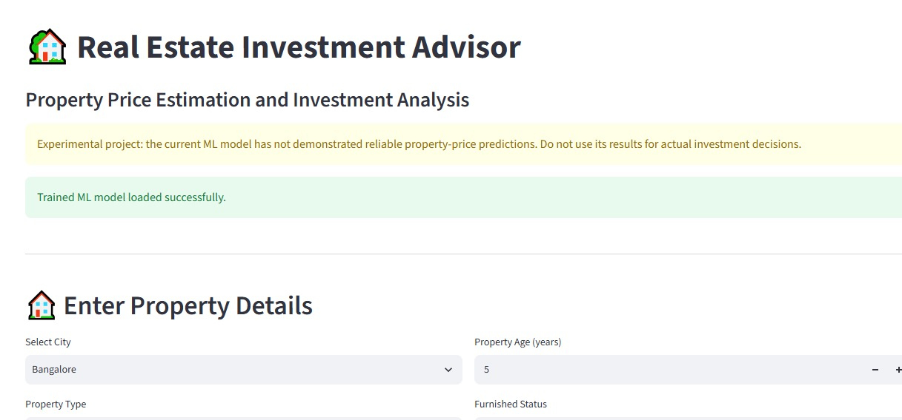

### Property Inputs

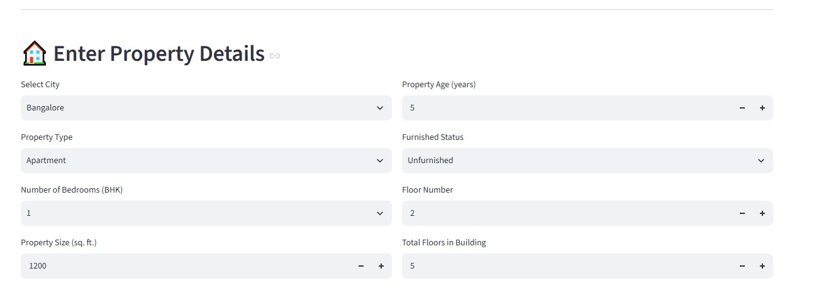

### Price Prediction

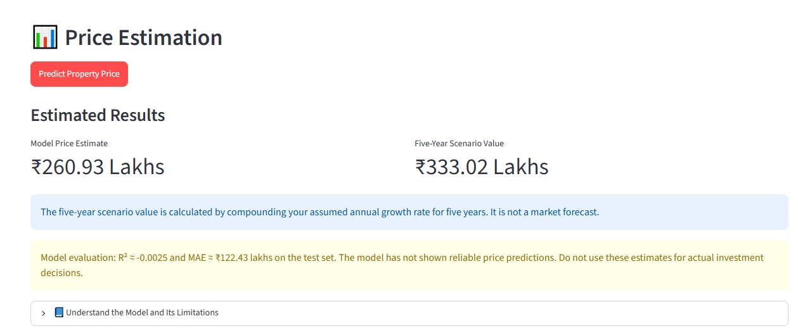

### Model Performance

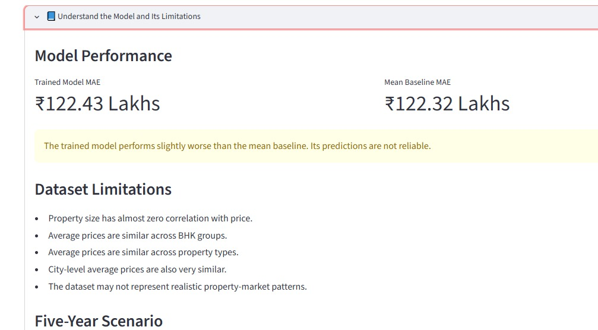

### Model Limitations

The application also communicates the limitations of the current model.

## 📉 Data Analysis and Visualizations

### Correlation Heatmap

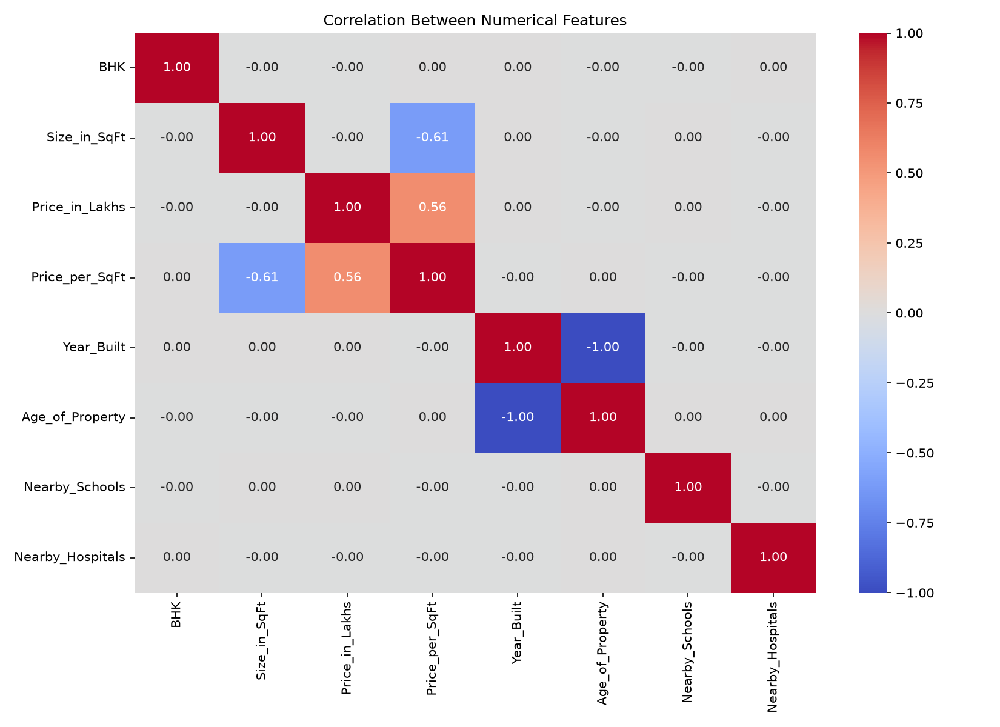

### Price Distribution

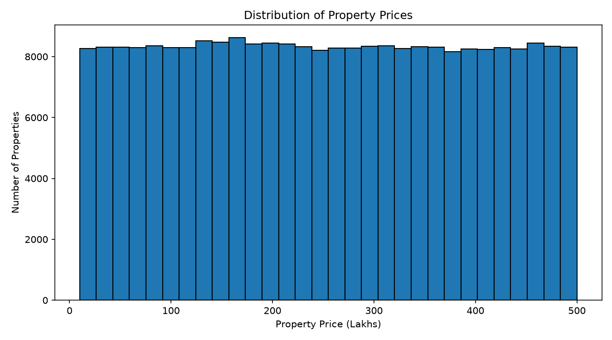

### Price by BHK

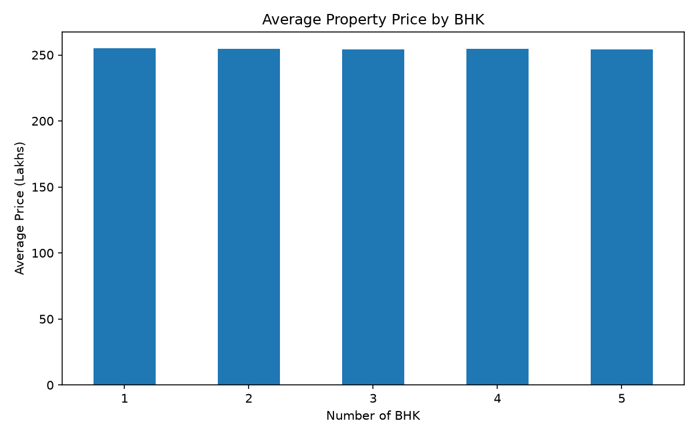

### Price by Property Type

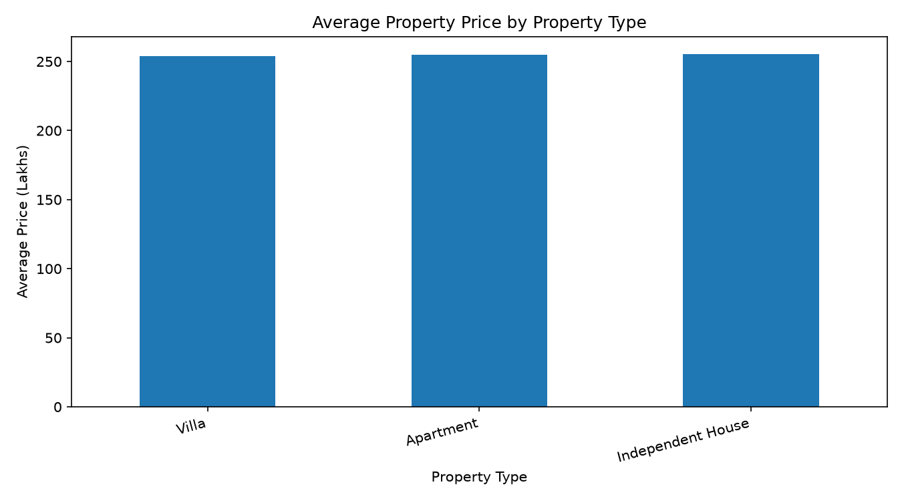

### Size vs Price

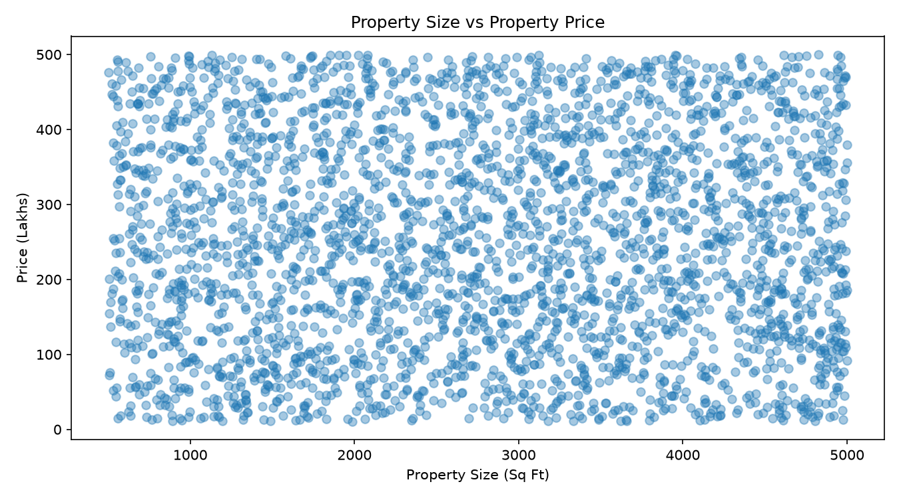

## 🔬 MLflow Experiment Tracking

MLflow is used to track model parameters and evaluation metrics.

The experiment records:
- Model name
- Dataset information
- Machine learning task
- MAE
- RMSE
- R²
- Baseline comparison metrics

### MLflow Dashboard


### Tracked Metrics

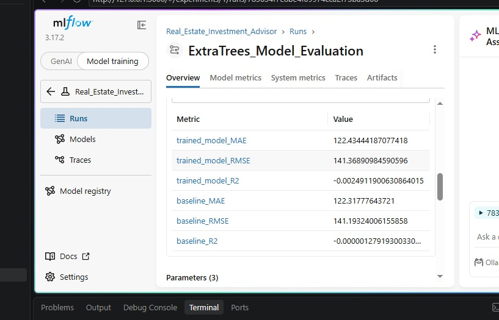

### Tracked Parameters

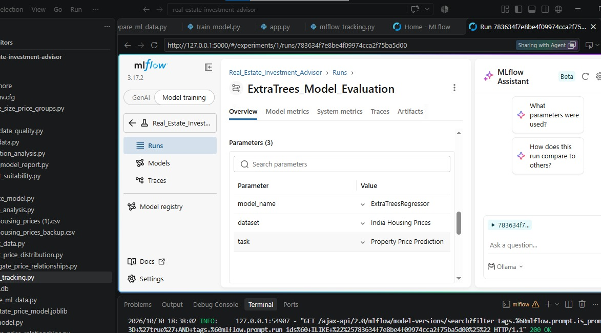

## 📈 Five-Year Future Value Scenario

The application provides an estimated future value using a user-selected annual growth rate.

This is a **hypothetical compound-growth scenario**, not a prediction learned from the machine learning model or a forecast of actual real estate market performance.

The result depends on the assumed growth rate entered by the user.

## 🚀 Installation and Execution

### 1. Clone the Repository

```bash
git clone https://github.com/lalithamakaraju-7/real-estate-investment-advisor.git
```

### 2. Navigate to the Project Folder

```bash
cd real-estate-investment-advisor
```

### 3. Create a Virtual Environment

```bash
python -m venv venv
```

### 4. Activate the Virtual Environment

For Windows PowerShell:

```powershell
.\venv\Scripts\Activate.ps1
```

### 5. Install Dependencies

```bash
python -m pip install -r requirements.txt
```

### 6. Run the Streamlit Application

```bash
streamlit run app.py
```

Open the local URL displayed in your terminal, usually:

```text
http://localhost:8501
```

## ⚠️ Model Limitations

The current dataset analysis indicates very weak relationships between the available features and property prices.

The model's evaluation results show that it does not outperform the mean baseline.

Potential areas for future improvement include:

- Investigating dataset quality and suitability.
- Identifying more meaningful property-market features.
- Incorporating location-specific market information.
- Exploring additional regression algorithms.
- Improving feature engineering.
- Re-evaluating model performance on suitable datasets.

The current model should be treated as experimental and should not be used for actual property valuation or investment decisions.

## 🔮 Future Enhancements

- Improve dataset quality and predictive performance.
- Explore additional machine learning algorithms.
- Add more meaningful real estate market features.
- Integrate reliable real estate market data.
- Improve the user interface and visualizations.
- Deploy the application online.
- Extend experiment tracking and model comparison.

## 👩‍💻 Author

**Lalitha Kamakshi Makaraju**

GitHub: [lalithamakaraju-7](https://github.com/lalithamakaraju-7)

Project Repository: [Real Estate Investment Advisor](https://github.com/lalithamakaraju-7/real-estate-investment-advisor)

## ⚖️ Disclaimer

This project is developed for educational and learning purposes only. It does not provide professional real estate investment, financial, or property valuation advice. All price estimates are experimental, and future value calculations are hypothetical scenarios.

